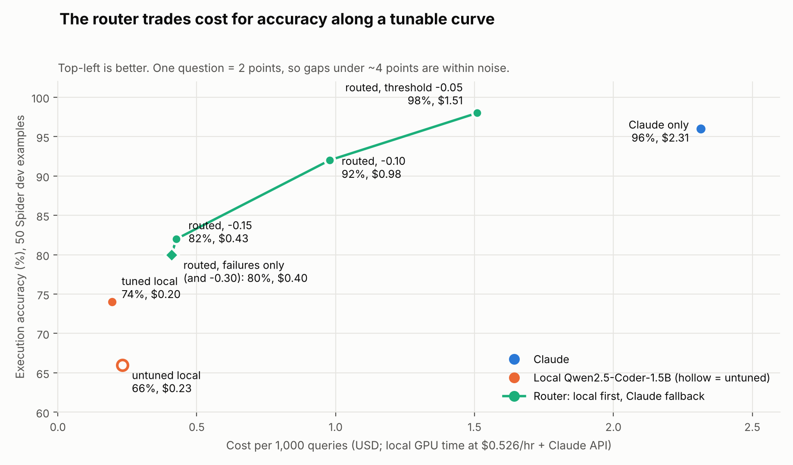

# datamind-router

**A Text-to-SQL agent that answers locally and calls Claude only when it has to.**

A LoRA-tuned Qwen2.5-Coder-1.5B model (served with vLLM) takes every question first. Its SQL passes through sqlglot AST guardrails and a read-only SQLite executor. If the result looks unsafe, broken or low-confidence, the router escalates that one query to Claude. Everything is benchmarked on a 50-example Spider dev subset for execution accuracy, p95 latency and cost per 1,000 queries.



## Highlights

- **92% accuracy at about 58% lower cost than Claude alone** ($0.98 vs $2.31 per 1,000 queries), with only 15 of 50 queries sent to Claude.
- **Matches Claude's accuracy at about 35% lower cost** (98% vs 96%, $1.51 vs $2.31). The 2-point gap is one query, so read it as parity, not a win.
- **LoRA fine-tuning lifted the local model from 66% to 74%** and cut guardrail rejections from 6 to 4, trained on a free Colab T4.
- **One knob moves you along the cost/accuracy curve**: the `--min-confidence` threshold on mean token logprob.
- **Cost is a stated, defensible number**: Claude API spend plus GPU time at $0.526/hr (AWS g4dn.xlarge, us-east-1, on-demand), not a guess.
- **Safe by construction**: exactly one read-only statement is allowed, and the normalized SQL, not the model's raw text, is what executes.
- **Ships with a FastMCP server**, so any MCP client can query the databases.

## Results

50 Spider dev examples, scored by execution accuracy: result sets are compared, and row order only matters when the query has `ORDER BY`.

Cost per 1,000 queries is Claude API spend plus local GPU time at **$0.526/hr** (AWS g4dn.xlarge, us-east-1, on-demand, checked 2026-10-10). Local GPU cost is `request latency x hourly rate`. An escalated query is also charged for the local attempt that was thrown away.

| Run | Accuracy | Cost / 1k queries | p50 latency | p95 latency | Answered by Claude |
|---|---|---|---|---|---|
| Claude only (`claude-sonnet-5-5`) | 96% (48/50) | $2.31 | 1.34 s | 2.49 s | 50 |
| Local, untuned Qwen2.5-Coder-1.5B | 66% (33/50) | $0.23 | 1.04 s | 3.85 s | 0 |
| Local, LoRA-tuned | 74% (37/50) | $0.20 | 0.97 s | 3.25 s | 0 |
| Routed, escalate on failure only | 80% (40/50) | $0.41 | 0.95 s | 3.88 s | 4 |
| Routed, min-confidence -0.30 | 80% (40/50) | $0.40 | 1.05 s | 3.98 s | 4 |
| Routed, min-confidence -0.15 | 82% (41/50) | $0.43 | 0.88 s | 3.98 s | 5 |
| Routed, min-confidence -0.10 | 92% (46/50) | $0.98 | 1.29 s | 4.46 s | 15 |
| Routed, min-confidence -0.05 | 98% (49/50) | $1.51 | 1.80 s | 5.03 s | 26 |

Per-run `summary.json`, `report.md` and serving configs are in [`benchmarks/`](benchmarks/).

### What the numbers say

- **The router gives a tunable trade-off.** Lowering the confidence bar sends fewer queries to Claude and costs less; raising it buys accuracy back.
- **Failure-only escalation is cheap but shallow.** Escalating just on guard rejections and execution errors recovers a few queries. The confidence signal catches most of the rest, because the local model's wrong answers are usually valid SQL that returns the wrong rows.

### Limitations

- **Small sample.** With n = 50, one query is 2 points. The +8-point tuning gain and the 98% vs 96% comparison are within noise.
- **Latency.** Routed p95 is worse than Claude alone, because an escalated query pays for the failed local attempt first.
- **Slow serving setup.** vLLM ran with `--enforce-eager` on a free Colab T4. A dedicated, optimized deployment would be faster and cheaper per query.
- **One training epoch** only.
- **Guardrail scope.** The AST checks catch invalid and unsafe SQL, not wrong-but-valid SQL such as a bad join. That is where the remaining failures are.
- **Pricing inputs.** The GPU rate and Claude's $2 / $10 per million input / output tokens come from public price pages and were not independently verified. Override Claude's with `--input-price` and `--output-price`.
- **MCP over HTTP has no authentication.** Keep it on loopback.

## How it works

```text
question + db_id
      |
      v
CascadeAgent --> local model (vLLM, LoRA-tuned) --> sqlglot guardrails --> SafeExecutor
      |
      |  escalate to Claude if: guard rejection, SQLite error, or mean logprob < threshold
      v
Claude (same pipeline) --> result + tokens + cost + latency + route
```

| Path | What lives there |
|---|---|
| `src/datamind/` | Agent, schema catalog, prompts, sqlglot AST guardrails, read-only SQLite executor (authorizer, timeouts), Claude and vLLM clients, pricing |
| `src/router/` | Spider-to-SFT data prep, LoRA training and merge, the cascade routing policy |
| `src/eval/` | Dataset loader, runner, execution-accuracy scoring, reports; backends `claude`, `local`, `routed`, `oracle` |
| `src/mcp_server/` | FastMCP server: tools `query_database`, `list_databases`, `describe_database`, `validate_sql`; resources `datamind://databases` and `datamind://schema/{db_id}`. See [docs/MCP.md](docs/MCP.md) |

## Quickstart

```bash
pip install -r requirements.txt
export ANTHROPIC_API_KEY=...        # never commit this
export PYTHONPATH=src

python -m eval.loader               # build the 50-example Spider sample into data/
python -m pytest -q

# Claude baseline
python -m eval.run_eval --backend claude --run-name claude_baseline

# Local model (served by vLLM) and routed runs
python -m eval.run_eval --backend local --local-model qwen2.5-coder-1.5b-tuned \
    --gpu-hourly-usd 0.526 --run-name tuned_qwen15b
python -m eval.run_eval --backend routed --local-model qwen2.5-coder-1.5b-tuned \
    --gpu-hourly-usd 0.526 --min-confidence -0.10 --run-name routed_conf_m10
```

Results are saved to `results/<run-name>/` (`results.jsonl`, `summary.json`, `report.md`). Run `python -m eval.run_eval --help` for all options.

## Reproduce the local model on a free Colab T4

Notebooks are in [`notebooks/`](notebooks/); troubleshooting is in [docs/COLAB.md](docs/COLAB.md).

1. `colab_baseline.ipynb`: serve the untuned model with vLLM and record the baseline.
2. `colab_train_lora.ipynb`: LoRA (r=16, alpha=32, 7 target modules) on the Spider train split, loss masked to the assistant reply, merged to fp16.
3. `colab_tuned_eval.ipynb`: serve the merged model and run the evaluation and routing sweep.

Keep your Anthropic key in Colab Secrets, not in the notebook.

## License

MIT. See [LICENSE](LICENSE).
